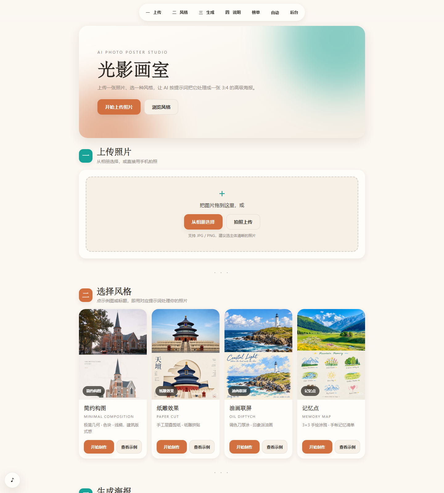
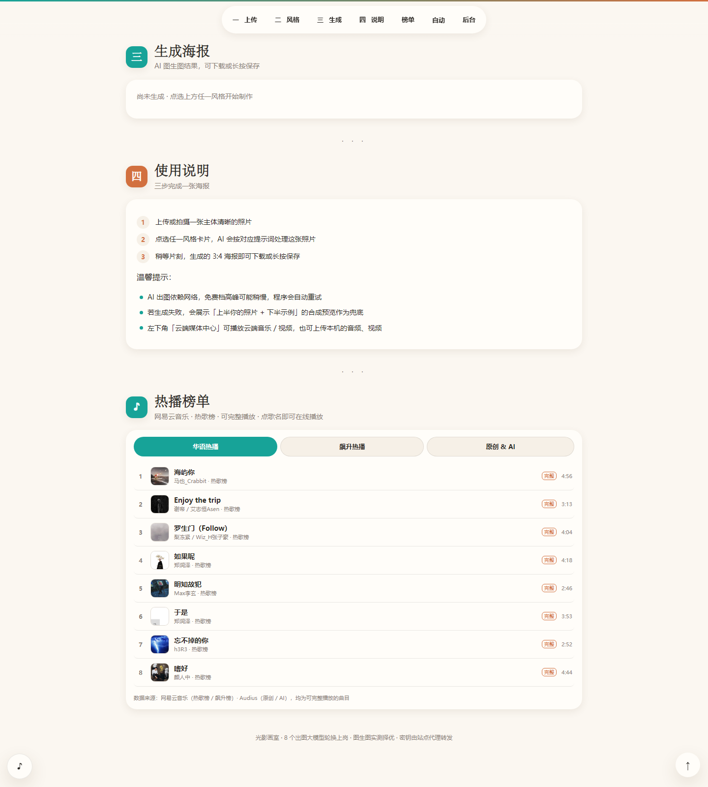

# 光影画室 Photopost

AI 照片 / 海报生成站点：选模板 → 填提示词 → 图生图出图，带管理后台与云端媒体。

- 线上：<https://photopost.pages.dev>（后台 `/admin`）
- 技术栈：Cloudflare Pages + Pages Functions + Cloudflare Worker（R2 读写）+ R2
- 部署：`.\deploy.ps1`（需要本机已安装并登录 `wrangler`）

## 截图





## 目录

```
index.html         首页（模板 + 提示词 + 生成 + 榜单 + 播放器）
admin.html         后台（示例图 / 音乐 / 榜单 / 设置）
deploy.ps1         一键发布静态页与 Functions
assets/            theme.css、示例图、音频、编码器
functions/         AI 代理 / 媒体 / 榜单 / 设置 / 登录
media-worker/      Cloudflare Worker（R2 读写）
```

## 配置

后台密码、`AGNES_KEY`、`MEDIA_TOKEN`、`SESSION_SECRET` 等全部通过 Cloudflare Pages / Worker 的
环境变量（Secrets）注入，仓库内不含任何密钥。自建部署时按下面的名字创建同名 Secret：

| Secret | 说明 |
| --- | --- |
| `ADMIN_PASSWORD` | 后台登录密码 |
| `AGNES_KEY` | 图生图 API Key |
| `SESSION_SECRET` | 登录态签名密钥（随机 32 字节） |
| `MEDIA_URL` | 媒体 Worker 基地址 |
| `MEDIA_TOKEN` | Pages 与 Worker 共享的上传/读取令牌 |
| `MEDIA_PUBLIC_URL` | R2 自定义域（可选，用于直出） |

```powershell
npm i -g wrangler
wrangler login
cd poster-demo
.\deploy.ps1
```
